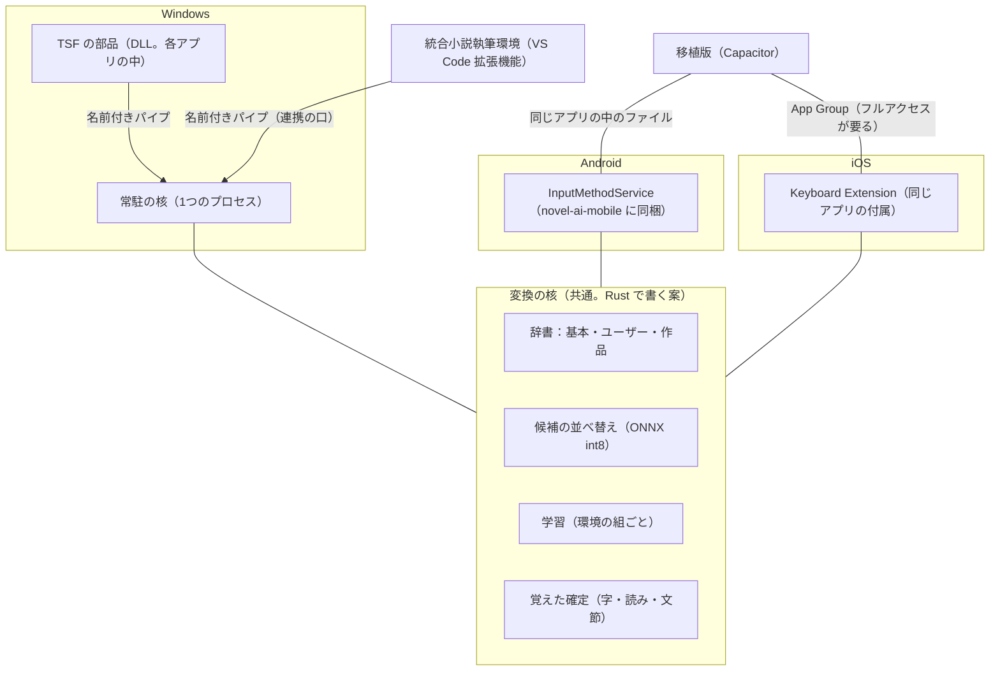
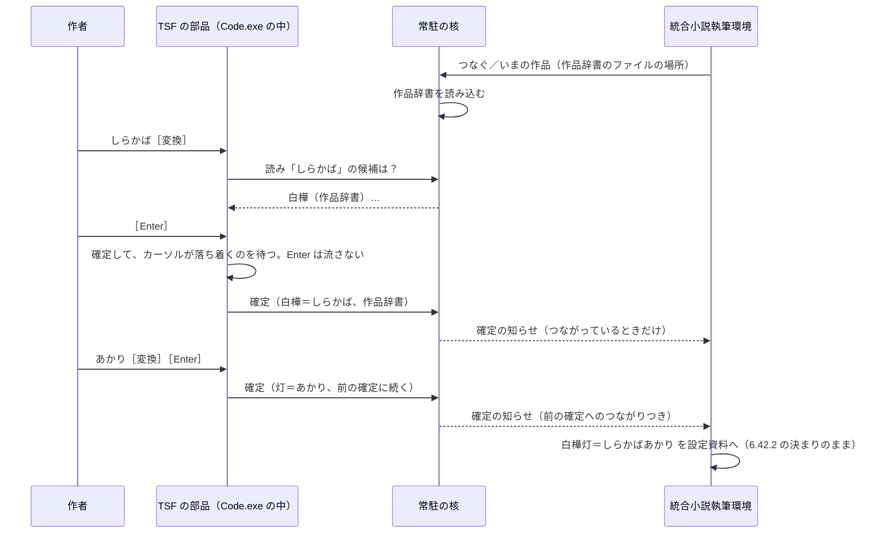

# オリジナルIME設計書（機能要件と設計の案）

作者の依頼（2026-11-03）「IMEの機能要件をまとめて設計書を作ってください。可能であればAndroid、iOSに移植します」で作った。出発点は [`オリジナルIMEの材料.md`](オリジナルIMEの材料.md)（以下「材料」。番号は材料の節の番号）。

**この文書の決まり**

- 材料・記録・調べた出典で確かめたことと、確かめていない推測は分けて書く。推測には **（見立て）** を付ける
- 出典は11章にまとめ、本文では〔出典 S-番号〕で指す
- まだ1行も作っていない。版（製品の版）とは別の文書で、作り始めたら設計書（`設計書.md`）の節として取り込むか、この文書を正として育てるかを作者に決めてもらう（10章 Q-10）

**言葉の短い説明**

| 言葉 | 意味 |
|---|---|
| IME | 日本語入力システム。かなを打って漢字にする部品（MS-IME・Google 日本語入力・ATOK など） |
| 変換中の字（未確定の字） | 下線が付いていて、まだ本文に入っていない字 |
| 確定 | 変換中の字を本文へ入れること |
| 文節 | 変換の区切り。「白樺／灯」の「／」で分かれた1つ1つ |
| 読み | その字を打つときに入れたかな（「灯」なら「あかり」） |
| TSF | Windows の IME を作る仕組み（Text Services Framework）。IME は各アプリの中に部品（DLL）として読み込まれる |
| InputMethodService | Android でキーボード（IME）を作る仕組み |
| Keyboard Extension | iPhone・iPad でキーボードを作る仕組み（`UIInputViewController`） |
| 核（変換の核） | かなを漢字にする中身。辞書と候補の並べ替え。3つの環境で同じものを使いたい部分 |
| 殻 | 環境ごとの外側。キーを受け、変換中の字を見せ、確定をアプリへ渡す部分 |
| ONNX・int8 | AI のモデルを入れる共通の形式（ONNX）と、数を8ビットに縮めて軽くする方法（int8。材料11の「量子化」） |
| 常駐の核 | パソコンにずっと居る1つのプロセス。各アプリの中の IME の部品はここへ問い合わせる |
| 名前付きパイプ | 同じパソコンの中のプロセス同士が話す口。外の機械からは届かない |

---

## 1. 目的と範囲

### 1.1 目的

小説を書く人のための日本語入力システムを作る。既存の IME（MS-IME など）で作者が実際に困ったこと（材料1〜10）を、IME の作りの側で無くす。あわせて、統合小説執筆環境が持っている作品の設定資料（人物名・地名・用語と読み）を、そのまま変換に効かせる（材料11 の最後の段「既存の IME に無い強み」）。

### 1.2 作るもの

1. **変換の核**：辞書（基本・ユーザー・作品）と、候補を並べ替える小さな AI のモデル、手元だけで行う学習
2. **Windows の殻**（TSF）：まずこれを作る
3. **統合小説執筆環境との取り決め**：確定ごとの読み・文節を渡し、いまの作品と設定資料の名前を受け取る
4. 可能なら **Android の殻**（InputMethodService）と **iOS の殻**（Keyboard Extension）。移植の作業場 `novel-ai-mobile`（Capacitor 方式、Android と iOS を同じリポジトリで出す）と並べて置く

### 1.3 作らないもの

- **変換の AI を一から作ること。** 既存のモデル（材料12・12-1）を土台にする。独自に作る価値があるのは「作者の作品で鍛える部分」と「材料1〜10 の IME の作りの問題」（材料12 の結論）
- **クラウドの変換。** 原稿も打鍵もパソコン・スマホの外へ出さない（4章 IME-N-03）
- **拡張機能の中の IME。** VS Code の拡張機能から IME は作れない（設計書6.13.1）。オリジナルIMEは別の製品として OS に入れる
- **既存の IME の辞書の自動切り替え**（MS-IME のレジストリを書き換えること。設計書6.13.5 の理由のまま、やらない）
- **音声入力・手書き入力**
- **アプリの中身を書き換えること。** IME は打った字を確定するだけで、作者の原稿を勝手に直さない（作品の決まり「作者の原稿を壊さない」）

### 1.4 統合小説執筆環境との関係

- オリジナルIMEは**どのアプリでも使える汎用の IME** として作る。メモ帳・ブラウザ・メールでも普通に使える
- 統合小説執筆環境と**つながっているときだけ**、作品辞書と確定の知らせが効く。つながっていなくても、汎用の IME として欠けなく動く
- 統合小説執筆環境の側は、オリジナルIMEが**無くても**今までどおり動く（設計書6.42.2 の推し量り・6.4.10 の確定 Enter の防ぎ・6.13 の辞書の書き出しは残す）

---

## 2. 利用者と場面

### 2.1 利用者

- 第一の利用者は作者本人（小説家。Windows のノートPC と母艦、タブレット、スマホ）
- 将来は、統合小説執筆環境を使うほかの書き手。IME の知識が無い人でも入れられ、戻せること

### 2.2 場面

| 場面 | どこで | 何が要るか |
|---|---|---|
| 本文を書く | 統合小説執筆環境の原稿エディター（縦書き・横書き。VS Code の中の WebView） | 作品の人物名が1回で出る／確定の Enter で改行や送信が起きない／執筆のキー（Ctrl+Alt+頭文字・F8 など）を変換中に取られない |
| 設定資料を直す | 設定資料パネル（WebView）、VS Code の普通のエディター | 作品の名前と読みが出る |
| AI と相談する | プロットモードの会話の欄・相談パネル | 確定の Enter で送信が始まらない（材料6） |
| ブラウザ版で書く | vscode.dev（外出先・タブレット） | 常駐の核に届かない。汎用の IME として動けば足りる |
| ほかのアプリ | メール・ブラウザ・Discord・投稿サイト | ふつうの日本語入力。作品辞書は切ってよい（環境ごとの辞書、IME-F-11） |
| スマホで書く | 移植版（novel-ai-mobile）・メモアプリ | 作品の名前が出る。iOS では制約が大きい（8章） |

### 2.3 作者の打ち方（材料から）

- 名前を姓と名で分けて確定する（「しらかば」→白樺、「あかり」→灯。材料1）
- 打ち直す（確定した字を Backspace で消して打ち直す。材料3）
- 予測変換で途中から候補を選ぶ（材料5）
- 縦書きで書く（材料8）

---

## 3. 機能要件

番号は **IME-F-xx**（IME の機能）と **IME-I-xx**（統合小説執筆環境との連携）。各要件に「なぜ」と「確かめ方」を付ける。確かめ方は CLAUDE.md の「繰り返し起きた失敗」2 に従い、**見逃し（効くべき所で効かない）と誤検出（効いてはいけない所で効く）の両方**を測る。

### 3.1 確定の知らせと読み

| 番号 | 要件 | なぜ | 確かめ方 |
|---|---|---|---|
| IME-F-01 | 確定のたびに、**文節ごとの「確定した字」と「その読み」**を持つ。1回の確定で複数の文節を確定したら、文節の並びをそのまま持つ | 材料1：姓と名を分けて確定すると、まとまりがどこにも無い。材料4：学習で区切りが変わる | 作者の19話から人物名を含む文を打ち、文節の字と読みの組が辞書の読みと合う割合（見逃し）と、別の語の読みが付く数（誤検出）を数える |
| IME-F-02 | **候補から選んだときも、辞書に載っている読みの全体**を持つ（打ったかなが途中まででも） | 材料5：「かん」で「漢字」を選ぶと読みが「かん」で切れる。1字の名前「あ」→灯 | 予測変換で選ぶ打ち方を20通り用意し、持った読みが辞書の読みと一致するか。打ったかなだけの読みが混ざった数を誤検出として数える |
| IME-F-03 | 連続して打った確定（姓→名）を、**IME が自分の確定の並びとして**覚える。間にカーソルの移動・別の欄への移動・取り消し（Esc）が入ったら並びを切る | 材料1：拡張機能が位置と15秒で推し量っている（設計書6.42.2） | 「白樺」「灯」を続けて確定→つながる。「白樺」のあとクリックで別の行へ移って「灯」→つながらない。両方を10回ずつ |
| IME-F-04 | **確定した字を Backspace で消したことを覚え**、並びから外す（消した確定の知らせ、IME-I-03） | 材料3：消した「蓮」が直前の確定として残り、白樺と灯がつながらなかった | 「蓮」確定→Backspace で消す→「白樺」「灯」→つながる。限り：マウスで選んで消した・アプリの取り消し（Ctrl+Z）・外で書き換わった、は IME に見えない（見立て）。この3つで「つながったと誤って言わない」ことを数える |
| IME-F-05 | 確定の処理は、**確定した字が本文に入り、カーソルが字の直後に落ち着いてから**終える。知らせ（IME-I-02）はそのあとに出す | 材料2：確定の知らせの瞬間に選択範囲が IME の置いた形のまま。入力（input）があとから届く組み合わせもある | 原稿エディターで、確定の知らせを受けた瞬間のカーソルの位置と選択の幅を100回記録し、字の直後で幅0でない回を数える。Chromium の中の並び（compositionend と input の順）は殻からは決めきれない（見立て）ので、段階1で実機で測る |

### 3.2 確定のキーと、執筆のキー

| 番号 | 要件 | なぜ | 確かめ方 |
|---|---|---|---|
| IME-F-06 | **確定に使ったキー（Enter・Space など）を、確定のあとでアプリへ流さない。** キーが離れるまで（keyup）IME が持つ | 材料6：確定の Enter が、確定のあとにふつうの Enter として届き、AI への送信が3回始まった | プロットモードの会話の欄で、確定の Enter を50回押して送信が始まった回（誤検出）と、確定していないときの Enter で送れなかった回（見逃し）を数える。統合小説執筆環境の防ぎ（`imeEnterGuardScript`）を外した版でも測る |
| IME-F-07 | **変換中に IME が使うキーを、執筆の道具と取り合わないように**最初から決める（3.2.1 の表）。作者が変えられる | 材料7：変換中の Ctrl+T が「半角英数」、F8 が「半角カナ」になり、執筆のキーが効かなかった | 3.2.1 の「IME が取らないキー」を変換中に押し、アプリへ届いた数（見逃しがあれば IME が奪っている）と、IME の機能が効いてしまった数を数える |
| IME-F-08 | 変換中に、IME が受け持たないキー（3.2.1 の「アプリへ渡すキー」）を押したら、**変換中の字を確定してから**キーをアプリへ渡すか、**変換中の字を残したまま**渡すかを選べる（既定は確定してから渡す、見立て） | 材料7：F8 で「メモへ飛ぶ」つもりが半角カナになった。いま製品は変換中の F8 を捨てている（設計書6.25.10） | 変換中に Ctrl+Alt+T を押し、誤字脱字の検知が走り、変換中だった字が確定されて本文に残ることを確かめる。字が消えた・化けた回を数える |

#### 3.2.1 キーの割り当ての案（材料7・設計書6.25.10 から）

統合小説執筆環境の原稿エディターでいま使っているキー：Ctrl+Alt+T／P／H／A／M／C／K／R、Ctrl+/、F8・Shift+F8、Alt+↑・Alt+↓、Ctrl+F、Ctrl+＋・Ctrl+－・Ctrl+0、Ctrl+S。F6・F7・F9・F10 は MS-IME と取り合うので製品は使っていない。

| キー | 変換中のオリジナルIME | 理由 |
|---|---|---|
| Ctrl+Alt+（字） | **取らない**（確定してアプリへ渡す） | 統合小説執筆環境の正式な割り当て |
| Ctrl+/、F8、Shift+F8 | **取らない** | メモのキー |
| Alt+↑・Alt+↓、Ctrl+F、Ctrl+S | **取らない** | 前後の話・探す・保存 |
| Ctrl+T（MS-IME の半角英数） | **取らない** | 材料7 |
| F6〜F10（ひらがな・カタカナ・半角・英数への変換） | 既定は**取る**（多くの人が指で覚えている）。作者が外せる | F8 だけは既定で取らない（メモのキーと重なる）。ほかを取るかは Q-05 |
| Space・変換 | 変換・次の候補 | ふつうの IME と同じ |
| Enter | 確定（キーは流さない。IME-F-06） | |
| Esc | 変換を取りやめる | |
| Tab・矢印 | 候補の移動・文節の伸び縮み | ふつうの IME と同じ |
| 無変換 | 直前の確定の選び直し（IME-F-17）の案 | 執筆と取り合わない空きキー（見立て） |

### 3.3 変換の当たり

| 番号 | 要件 | なぜ | 確かめ方 |
|---|---|---|---|
| IME-F-09 | **作品辞書**：統合小説執筆環境から受け取った「いまの作品の設定資料の名前・別名・用語と読み」を、その間だけ辞書に足す。学習を待たずに1回で出る | 材料4：4回目でやっと「白樺灯」が1回で出た。材料11：当たりを上げるのに一番効くのは設定資料を辞書に足すこと | 作者の19話に出る人物名・地名・造語のすべてを読みから変換し、第一候補に出た割合（見逃し）。作品辞書を入れたことで、ふつうの語の第一候補が変わった数（誤検出：例「灯がともる」の「灯」）を、作品辞書なしと比べる |
| IME-F-10 | 作品辞書の語は**ふつうの日本語を押しのけない**。1字の語・設定資料の見出しの語・モブは、作品辞書でも第一候補へ上げない（候補には出す） | 設計書6.13.2：「学校」を地名、「父上」を人名として入れると普段の入力が悪くなる。1字の名前は一般の語とぶつかる | 上の誤検出の数。ふつうの文（作者の原稿から人物名を含まない文1,000）の変換結果が、作品辞書の有無で変わった数が0に近いこと |
| IME-F-11 | **環境ごとの辞書の切り替え**：使っているアプリ（Windows ならプロセス名、Android ならパッケージ名）と、統合小説執筆環境が知らせる「いまの作品」で、使う作品辞書・ユーザー辞書の組を変える。作者が組を決められる | 作者の要望（2026-10-24）「使われるフォルダ、ソフト等環境を識別して辞書を切り替え」 | 環境を3つ（原稿エディター・メール・ブラウザ）用意し、作品の人物名がメールでは第一候補に出ないこと（誤検出）と、原稿では出ること（見逃し）。iOS はアプリが分からない（8章）ので、作者が選んだ組だけで切り替わることを確かめる |
| IME-F-12 | **環境ごとの学習**：候補の選び方の学習（どれを先に出すか）を、環境の組ごとに分けて持つ。混ぜる・分けるを作者が決められる | 作者の要望（2026-10-24）「環境ごとに優先順位等の学習を進める」。材料4：並べ替えは IME の学習の担当で、外からは届かない（設計書6.13.5） | 原稿で「固い」を選び続けたあと、メールで「硬い」の順位が変わらないこと。混ぜる設定では変わること |
| IME-F-13 | **候補の並べ替えの AI**：辞書で候補（下書き）を作り、小さなモデルで並べ替える（6章） | 材料11・12：どの既存の作りも「辞書で下書き → AI で選び直す」の2段 | 作者の19話の本文の読みから変換し、文の誤変換の数を、辞書だけ・AI あり・作品辞書あり、の3通りで比べる。1回の時間（4章 IME-N-01）も同時に記録する |
| IME-F-14 | **小説の書き方を壊さない**：ルビの記法（`｜漢字《かんじ》`）・`……`・`――`・全角空白の字下げ・会話の「」を、打ちやすく、変換で崩さない（短い読みの登録など） | 設計書6.13.1：記号が打ちにくいのは辞書で解ける見込みだが未検証 | 記号を含む作者の原稿の行200を読みから打ち直し、記号が別の字に化けた数・余計な空白が入った数 |

### 3.4 選び直し（再変換）

| 番号 | 要件 | なぜ | 確かめ方 |
|---|---|---|---|
| IME-F-15 | **確定した字と読みを、IME の側で覚えておく**（いまの欄の、直前のいくつかの確定。IME-N-03 の決まりで手元だけ） | 材料10：Chromium は Windows の再変換の仕組み（`ITfReconversion`）に対応しておらず、VS Code では再変換が使えない（設計書6.25.6） | 覚えた件数と、その確定がまだ本文にあるか（IME-F-04）が合っているか |
| IME-F-16 | **任意の選んだ範囲の再変換**：アプリがその仕組みに対応していれば使う（メモ帳・Word など） | 作者の依頼（2026-08-27）「文章範囲選択して再変換の機能も欲しいです」 | 対応するアプリで、選んだ範囲が正しい読みで候補に出る割合 |
| IME-F-17 | **直前の確定の選び直し**：アプリが再変換に対応していなくても、IME が覚えている直前の確定なら、キー1つ（案：無変換）で候補を出し直し、選んだ字で置き換える（Backspace で消して入れ直す形。見立て） | 材料10 の「オリジナルIMEなら」：確定した字と読みを覚えておけば、アプリの対応を待たずに選び直せる（見立て） | 原稿エディター（Chromium）で、直前の確定を選び直して本文が正しく置き換わる割合。**余計な字を消した・足りなく消した回を0にする**（作者の原稿を壊さない。IME-N-05） |
| IME-F-18 | 統合小説執筆環境の原稿エディターでは、**選んだ範囲の字と、覚えている読み**を拡張機能と IME の間でやり取りして、選んだ範囲の再変換を行う（IME-I-05。見立て） | Chromium の対応を待たずに、自前の原稿エディターでだけは任意の範囲を選び直せる | 選んだ範囲が過去に打った確定の並びと合うときに候補が出る割合（見逃し）。合わない範囲で別の読みを当てた数（誤検出） |

### 3.5 変換中の見た目

| 番号 | 要件 | なぜ | 確かめ方 |
|---|---|---|---|
| IME-F-19 | 変換中の字の見た目（線の種類・太さ・色・背景）を、TSF の表示属性で指定し、**作者が選べる**（例：線なし・点線・太線） | 材料8：縦書きで変換中の線が行の左に出る。CSS では動かせない | 縦書きの原稿エディターで、選んだ見た目どおりに描かれるかを写真で見る。**右へ動かせるかは分からない**（見立て：線の位置はブラウザが描く）。動かせないと分かったら「線なし＋文節の境目だけ」の案を試す |
| IME-F-20 | 見た目の指定で、**打鍵の反応を落とさない** | 作者（2026-09-24）「入力の反応がわずかに悪い気がするので、文字の変換時の色替えはいらない」——このときはページの側で色を塗っていた | IME-N-01 の時間を、見た目の指定あり・なしで比べる |
| IME-F-21 | 変換中の字は**本文に入れない**（アプリが変換中を知らない作りでも、変換中の字を IME の窓に出す選択肢を持つ） | 材料9：VS Code の普通のエディターでは変換中の字が打鍵ごとに本文へ入る | 普通のエディターで、変換中に文書の変更が届いた数。**限り**：これは VS Code（Monaco）の作りで、IME の側からは変えられない見込み（見立て）。製品の側の逃げ（800ms 待つ、設計書の用語ハイライト）は残す |

### 3.6 そのほか

| 番号 | 要件 | なぜ | 確かめ方 |
|---|---|---|---|
| IME-F-22 | **既存の IME の辞書を読み込める**（MS-IME・Google 日本語入力の書き出し形式。設計書6.13.4 の形式。ATOK は 6.13.4 で形式が未検証なので、確かめるまで入れない） | 乗り換えのとき、作者の今のユーザー辞書を捨てさせない。統合小説執筆環境の「IME辞書出力」もそのまま使える | 6.13.4 の3形式を読み込み、件数が書き出した件数と一致するか。読めない行を黙って捨てず、件数で知らせるか |
| IME-F-23 | **よく選び直す変換を溜め**、統合小説執筆環境へ「辞書に足しますか」の材料として渡せる（連携の道⑥） | 材料「連携の道の案」⑥ | 溜めた組が作者の選び直しの記録と合うか |
| IME-F-24 | **入れる・戻すが簡単**：入れても既定の IME は変えない。外す手順が1つの画面で済む | 設計書6.13.5：IME を壊すと執筆が止まり、しかも原因に気づきにくい | 作者が手順書どおりに入れて、MS-IME へ戻せるか（段階0b） |

### 3.7 統合小説執筆環境との連携

形は7章。

| 番号 | 要件 | なぜ | 確かめ方 |
|---|---|---|---|
| IME-I-01 | **読みを外へ渡す**：確定のたびに、文節ごとの字と読み・どの辞書から出たか・候補から選んだか、を渡す | 材料1・5。設計書6.42.2 の推し量り（位置と15秒・読みの字数）が要らなくなる | 6.42.2 の引き当て（`captureImeReading`）にこの知らせを流したとき、人物の読みが正しく埋まる割合と、誤った読みを提案した数を、推し量りの道と比べる |
| IME-I-02 | 知らせは**確定が本文に落ち着いてから**出す（IME-F-05） | 材料2 | IME-F-05 と同じ |
| IME-I-03 | **消した確定の知らせ**：IME が通した Backspace で確定の字を消したら、その確定を取り消す知らせを渡す | 材料3 | IME-F-04 と同じ |
| IME-I-04 | **いまの作品と設定資料の名前・読みを受け取る**（作品が変わったら入れ替える） | IME-F-09・IME-F-11 | 作品を切り替えて5秒以内に、新しい作品の人物名が第一候補に出るか。前の作品の名前が残った数 |
| IME-I-05 | 原稿エディターで選んだ範囲の再変換を頼む／答える | IME-F-18 | IME-F-18 と同じ |
| IME-I-06 | **つながっていないときは何も出さない**：統合小説執筆環境が接続していないとき、IME は確定の知らせを外へ書かない（溜めもしない） | IME はすべての打鍵を見る（材料「気をつけること」）。キーを盗み見る道具にしない | 接続していない状態で1時間打ち、外へ書かれた知らせが0件か |
| IME-I-07 | **パスワード欄・学習しないでほしい欄では知らせも学習もしない**（Windows の入力欄の種類〈InputScope〉がパスワード、Android の `IME_FLAG_NO_PERSONALIZED_LEARNING`・パスワードの種類） | Android の文書の注意〔S-08〕〔S-09〕 | パスワード欄で打って、知らせ・学習・覚えた確定が0件か |

### 3.8 局面の木（学習と辞書の分け方）

作り方は 6.5。IME-F-11・12 の「環境の組」を、この木で置き換えて広げる（作者の答え Q-06、2026-11-03 夜）。

| 番号 | 要件 | なぜ | 確かめ方 |
|---|---|---|---|
| IME-F-25 | **局面の木**を持つ。「共通」を根に、日常・仕事・創作のような大きい局面から、創作→小説→ジャンル→作品のように細かくする。学習と辞書は木の段ごとに持つ | Q-06「大きい階層から…使う局面ごとに切り替えます」 | 初期の木で、局面を作る・選ぶ・閉じるを一通り行い、学習と辞書がその段に置かれた数と、別の段に置かれた数 |
| IME-F-26 | **下の段は上の段の学びと辞書を使える。下で学んだことは上と兄弟へ漏れない。** 同じ読みで食い違ったら、いまの局面に近い段が勝つ | ファンタジーの作品で選んだ当て字が、仕事のメールで第一候補に出てはいけない。一方、日常で覚えた語は小説でも出てほしい | 子の局面で「燈」を選び続けたあと、親と兄弟の局面で順位が変わった数（誤検出）。親で学んだ選び方が子で効かなかった数（見逃し） |
| IME-F-27 | **作者が木を作る・名前を変える・動かす・まとめる・消す。** 消す・まとめるときは、その段の学びを親へ混ぜるか捨てるかを作者に訊き、黙って混ぜない・捨てない | 作品の決まり「作者が書いたデータを上書きしない」。学びは作者が育てたもの | 木の操作を20通り行い、学びの件数が作者の選んだとおりに動いたか。訊かずに消えた・混ざった件数を0にする |
| IME-F-28 | **切り替えの判定は手がかりの順で決める**（6.5.4）：作者の手 ＞ 連携ソフトの知らせ ＞ アプリと窓の題名の決まり ＞ AI の推し量り ＞ 直前の局面 | Q-06「ソフトウェアとの連動、ユーザーの切り替え、利用アプリで切り分け、AI制御」。手がかりごとに確かさが違う | アプリの切り替え・作品の知らせ・手の切り替えを混ぜた台本を100手流し、切り替わるべき所で替わらなかった数（見逃し）と、替わってはいけない所で替わった数（誤検出） |
| IME-F-29 | **AI の推し量りは手元だけ。** 直前の確定はメモリの中だけで使い、ディスクにも外にも出さない。残すのは推した局面の名と確かさだけ。いまの枝を下へ絞るだけで、兄弟の局面（仕事→創作など）へは飛ばない | IME はすべての打鍵を見る（材料「気をつけること」）。6.3「打った文章は覚えない」 | 作者の19話とメールの文を流し、当てた割合（見逃し）と誤って切り替えた数（誤検出）。推し量りの間にディスクへ書かれた文が0件か。IME-N-01 の時間に収まるか |
| IME-F-30 | **誤って切り替えても作者の学びを汚さない**：確かさの低い判定の間は、一つ上の段で学ぶか仮置きにし、確かになったら移す・外れたら捨てる | 6.3「通ったときだけ覚える」と同じ考え。外れた推し量りで作品の学びが崩れると、作者には原因が見えない | わざと外れた局面に10分置いてから作者が正しい局面へ替え、正しい局面と外れた局面の学びの件数が想定どおりか |
| IME-F-31 | **いまの局面と、何で決まったかを作者に見せる**（6.5.6） | 局面が見えないと、変換が悪くなった理由に作者が気づけない（設計書6.13.5 の「原因に気づきにくい」と同じ） | 切り替わった瞬間を20回作り、表示が替わらなかった数・遅れた数。AI で推したときに「推し量り」の印が出なかった数 |

---

## 4. 非機能要件

番号は **IME-N-xx**。

| 番号 | 要件 | 中身 | 確かめ方 |
|---|---|---|---|
| IME-N-01 | **速さ** | 1打鍵の処理（変換中の字を見せ直すまで）は**16ミリ秒以内**（画面の1こま）を目標、**50ミリ秒を上限**とする（見立て：材料11「1打鍵ごとの答えは数十ミリ秒の内」）。AI の並べ替えは打鍵ごとではなく、変換（Space）のときと打鍵が止まったときだけ走らせ、間に合わなければ辞書だけの候補を先に出す | 作者の19話の読みを流し、1打鍵と1変換の時間の分布（中央・99番目）をノートPC（CPU だけ）で測る |
| IME-N-02 | **最初の表示** | パソコンを起こして最初の1字を打つまでに、変換の核が起きていなくても、**かなはすぐ出る**（漢字の候補は核が起きてから） | 常駐の核を止めた状態で打ち、かなが出るまでの時間 |
| IME-N-03 | **手元で動く・原稿をクラウドへ送らない** | 変換・学習・知らせはすべてその機械の中。核は外へ通信しない（モデルの取得とその検算だけは、作者が押したときだけ。IME の部品の中では通信しない）。学習の記録・覚えた確定は**同期しない**（設計書6.42.2 の控えと同じ扱い） | 打っている間の通信を見張り、0件か。学習の記録が Git や同期のフォルダーに入っていないか |
| IME-N-04 | **電池** | 使っていないときは核がメモリとCPUを返す（setsuna-ime は最後のアプリが離れて10分で終わる作り〔S-01〕）。スマホではキーボードを閉じたら大きなものを放す（Android の文書の勧め〔S-07〕） | ノートPCで1時間書いたときの電池の減りを、MS-IME と比べる（見立ての比べ方） |
| IME-N-05 | **壊れたときに作者の入力を止めない** | 核が落ちた・答えない・モデルが読めないときは、**打ちかけの字を確定して、かなのまま入力できる形へ戻る**（setsuna-ime の作り〔S-01〕と同じ考え）。アプリを巻き込んで落とさない。核は自分で起き直す | 核をわざと止める・モデルのファイルを壊す・答えを2秒遅らせる、の3通りで、打った字が消えないか・アプリが落ちないか |
| IME-N-06 | **学習の記録を壊さない** | 学習・ユーザー辞書の書き込みは、書いてから入れ替える形（途中で落ちても前のものが残る）。壊れた記録は直さずに使わず、作者に知らせる（作品の決まり「壊れたJSONは直さず止める」と同じ） | 書き込みの途中で落とし、次の起動で前の記録が残っているか |
| IME-N-07 | **許諾** | モデル・辞書・エンジンの許諾を、配るものごとに表記して同梱する（6.4）。CC BY-SA のものを改変して配るときは同じ条件で公開する | 配るものの一覧と許諾の文が揃っているかを、配る前の検査で見る |
| IME-N-08 | **メモリ** | Windows：核1つで数百MB以内（見立て）。iOS：キーボードは約50〜60MBで OS に止められる、という開発者の記事がある〔S-12〕（Apple の公式の数ではない。見立て）。iOS では並べ替えのモデルを載せられない場合を最初から考える | 各環境で核を載せたときの使用量を測る |
| IME-N-09 | **権限を広げない** | 管理者の権限で動くアプリでは、別の子のプロセスを使う（setsuna-ime の作り〔S-01〕）。アプリの箱（AppContainer）の決まりを回り道で越えない（越えるとマルウェア扱いで止められる〔S-05〕） | ストアアプリ・管理者のアプリで変換できるか、核に余計な権限が要っていないか |
| IME-N-10 | **同じ読みには同じ答え** | 3つの環境で、同じ辞書・同じモデルなら同じ候補が出る。ONNX Runtime の版を変えると int8 の数値と候補が変わる〔S-01〕ので、版を固定し、変えたら測り直す | 同じ1,000文の読みを3環境で変換し、第一候補の違いの数 |

---

## 5. 全体の作り

### 5.1 3つの層



- **核**は環境に依らない部品。辞書を引き、候補を並べ、学習し、確定を覚える。画面もキーも知らない
- **殻**は環境ごと。キーを受け、変換中の字と候補を見せ、確定をアプリへ渡す
- **連携の口**は核の側に置く。IME の部品（各アプリの中で動く）からは通信しない

### 5.2 Windows：部品と常駐の核に分ける

- TSF の IME は**各アプリのプロセスの中**に DLL として読み込まれ、そのアプリの箱（AppContainer）の制限をそのまま受ける。アプリが通信を許されていなければ IME も通信できない〔S-05〕
- そこで **DLL は薄くし、変換は1つの常駐の核に問い合わせる**。setsuna-ime はこの形で、ログインごとに1つの共有の核を名前付きパイプで全アプリから使い、モデルはメモリに1つだけ載る。最後のアプリが離れて10分で終わる。管理者のアプリには専用の子のプロセス、ストアアプリ（AppContainer）は共有の核へつなぐだけ〔S-01〕。rakukan も TSF の DLL と `rakukan-engine-host.exe` に分けている〔S-02〕
- 材料「連携の道の案」④（常駐のプロセスを1つ置き、名前付きパイプでつなぐ）と同じ形が、既存の IME で実際に動いている。**常駐の核が「変換の核の置き場」と「統合小説執筆環境との連絡口」を兼ねる**のを本命にする
- 登録：IMM32 の IME は塞がれる。TSF で作る〔S-05〕。レジストリへ直に書かず `ITfInputProcessorProfileMgr::RegisterProfile`、すぐ使うなら `InstallLayoutOrTip`〔S-05〕。ストアアプリでも動く印に `GUID_TFCAT_TIPCAP_IMMERSIVESUPPORT` を登録〔S-05〕
- 辞書・モデルの置き場：アプリの箱の中から読めるのは Program Files・Windows の下、それ以外は ACL（読める人の一覧）を足す必要がある〔S-05〕。setsuna-ime は `%LOCALAPPDATA%` に置き、DLL・エンジン・モデル・設定のフォルダーだけを箱から読めるように開き、学習の記録は開いていない〔S-01〕
- インストールは管理者の確認（UAC）が要る（setsuna-ime の `regsvr32`、rakukan の setup.exe〔S-01〕〔S-02〕）。rakukan は導入・更新に再起動が要る〔S-02〕
- **署名**：OS が IME の DLL に署名を必ず求める、という記述は調べた範囲では見つからなかった（rakukan はソースからの無署名の導入手順を持つ〔S-02〕）。配る setup.exe に署名が無いと SmartScreen の警告が出る（見立て）。署名の要否は Q-08

### 5.3 統合小説執筆環境との連携の道（材料の①〜⑥から）

| 道 | 中身 | 判断 |
|---|---|---|
| ① 窓の題名で切り替え | 前面のアプリと窓の題名（VS Code ならファイル名とフォルダー名）から作品を推す | **補助**。つながっていないとき（ブラウザ版・接続前）の推し量りに使う。外れても辞書の組が変わるだけ |
| ② 決まった場所のファイル | 「いまの作品・話・辞書」をファイルで渡す | **作品辞書の受け渡しに使う**。拡張機能が作品辞書を決まったフォルダーへ書き、核が読む。大きな辞書を毎回パイプで送らない |
| ③ 辞書の書き出し | いまの製品の形（設計書6.13） | **残す**。既存の IME の人のため。オリジナルIMEは同じファイルを読める（IME-F-22） |
| ④ 常駐＋名前付きパイプ | 核と拡張機能を同じ機械の中の口でつなぐ | **本命**。確定の知らせ・いまの作品・再変換の頼み。setsuna-ime が同じ形〔S-01〕。拡張機能（Node）は名前付きパイプに繋げる |
| ⑤ 常駐が MCP の客になる | 核が統合小説執筆環境の MCP サーバーへ問い合わせる | **やらない**（いまは）。核が問い合わせる側になると、核が拡張機能の作りを知ることになる。④で拡張機能から押し込めば足りる |
| ⑥ 選び直しを溜めて辞書へ | IME が溜め、製品が「辞書に足しますか」と訊く | **段階3**。IME-F-23 |

**本命を④（＋作品辞書は②）にする理由**

1. 既存の IME（setsuna-ime）が同じ形で動いており、IME の部品から通信しないで済む
2. 名前付きパイプは同じ機械の中でしか届かない。原稿と打鍵を外へ出さない決まり（IME-N-03）と合う
3. 拡張機能が客になり、つながっている間だけ知らせが流れる（IME-I-06）。拡張機能が居ないとき IME は何も溜めない
4. 作品辞書をファイル（②）にすると、パイプが切れても前の作品辞書で変換が続く

**使えない所の代わり**

| 所 | ④が使えない理由 | 代わり |
|---|---|---|
| ブラウザ版（vscode.dev） | 拡張機能は Web Worker の中で動き、名前付きパイプも外のプロセスも呼べない（設計書5.8.1） | IME は①の推し量りで作品辞書の組を選ぶだけ。拡張機能は 6.42.2 の推し量り（原稿エディターの変換の知らせ）を今までどおり使う。メニューからは連携の操作を隠す（設計書5.8.16） |
| Android | パソコンの常駐の核が無い | IME を移植版（novel-ai-mobile）と**同じアプリに同梱**し、同じアプリの領域のファイルで作品辞書と知らせを渡す（見立て：同じアプリなら同じ領域を読める）。別のアプリにするなら ContentProvider（アプリ間でデータを渡す仕組み）を使う（見立て） |
| iOS | 常駐も通信もできない。キーボードはアプリを知らされない | 移植版とキーボードを App Group（同じ作り手のアプリ同士の共有フォルダー）でつなぐ。**キーボード側から共有のフォルダーを使うにはフルアクセスが要る**〔S-11〕。フルアクセスが無ければ、キーボードに入れた時点の辞書だけで動き、作者がキーボードの上で作品を選ぶ |

### 5.4 IME と拡張機能の間で起きること（Windows の例）



---

## 6. 変換の核

### 6.1 辞書

| 辞書 | 中身 | 出どころ | 書き換えるのは |
|---|---|---|---|
| 基本辞書 | ふつうの日本語の語と読み | 既存の公開辞書（6.4 の許諾を見て選ぶ） | 配る側（更新は作者が押したとき） |
| ユーザー辞書 | 作者が足した語。既存の IME から読み込んだ語（IME-F-22） | 作者 | 作者だけ |
| 作品辞書 | いまの作品の設定資料の名前・別名・用語と読み | 統合小説執筆環境が書き出す（②） | 拡張機能だけ。IME は読むだけ |
| 記号の短い読み | `……` `――` `｜《》` など | 配る側の初期値＋作者 | 作者 |

- 作品辞書に入れる語の選び方は設計書6.13.2 をそのまま使う（モブ・1字の語・見出しの語は入れない、読みは作者が入れたものか、かなから作れるもの）。読みはひらがなに直してから渡す（6.13.3）
- 作品辞書は**その作品の間だけ**効く。作品を閉じたら外す（IME-F-11）
- 作者の書いたデータを上書きしない：IME は作品辞書を書き換えない。学習で作品辞書の読みを変えない

### 6.2 候補の並べ替えのモデル

**作りは2段**：辞書で候補（下書き）を作り、小さなモデルで並べ替える（材料11・12。既存の作りはどれもこの形）。

| 候補 | 形 | 許諾 | 3環境で動くか | 判断 |
|---|---|---|---|---|
| **Aster-v1.2-small** | ONNX int8、約29MB、一字ずつでなく一度にまとめて出す方式（CTC）〔S-03〕 | Apache-2.0〔S-03〕 | 素の ONNX なので、ONNX Runtime が動く所なら同じものが動く見込み（見立て） | **第一候補** |
| Bletilla-v0.1-small | ONNX、ただし独自の演算（MoE）＋ GGUF の並べ替え役（llama.cpp）〔S-01〕 | Apache-2.0（材料12-1） | 独自の演算は setsuna のエンジンでしか読めない見込み。スマホへ持っていきにくい（見立て） | Windows だけの上位版の候補 |
| zenz-v3.2（small・xsmall） | GPT-2 系、一字ずつ順に出す。azooKey で使われる | Apache-2.0。ただし基のモデルと学習データが書いていない（材料12-1） | CPU だけでは「とても遅い」と Windows 版の説明にある（材料12） | 比べる相手 |
| zenz v1〜v3.1・jinen | GPT-2 系・Qwen3 系、GGUF | CC BY-SA 4.0（材料12-1） | llama.cpp が要る | 比べる相手（配るなら継承の条件） |

**Aster を第一候補にする理由**

1. 形が素の ONNX int8 で小さい（29MB）。Windows・Android・iOS で同じモデルを同じ道で動かせる見込みがいちばん高い
2. 一度にまとめて出す方式なので、一字ずつ順に出す GPT-2 系より速い見込み（材料12 の shion の「約13ミリ秒」は前の版の公表値。Aster のページには速さの記述が無い〔S-03〕。見立て）
3. Windows で動く実物（setsuna-ime、MIT）がある〔S-01〕。段階0 ですぐ作者の作品で測れる
4. 許諾が Apache-2.0

**許諾の注意（材料12-1 を、2026-11-03 にモデルのページで読み直した）**

- Aster-v1.2-small のページに書かれた学習データは、FineWeb-2 日本語（ODC-BY 1.0）・日本語版 Wikipedia・Wikibooks・Wiktionary（CC BY-SA 4.0）・Wikinews（CC BY 2.5）・青空文庫・Tatoeba（CC BY 2.0 FR）・白書（政府標準利用規約）・Apache-2.0 の AI で作った合成文（約1%）〔S-03〕
- **材料12-1 が心配した livedoor ニュースコーパス・Amazon Reviews Multi・JESC は、今回読んだページの要約には見当たらなかった**（ページの全文は自分の目で読んでいない。材料が何を見てそう書いたかは分からない。Bletilla は読み直していない）。外れていたと決めず、配る前にもう一度全文で確かめる
- 残る不確かさ：蒸留の教師に zenz-v3.2-small（学習データ非公開）、初期値に非公開の shion-v4.2-small を使っている〔S-03〕。学習データの CC BY-SA が、モデルにどう及ぶかは法律の判断で、ここでは決めない
- **辞書の許諾を忘れない**：setsuna-ime の読みの辞書・解析器の辞書は `esehe/setsuna-ime-dict` で **CC BY-SA 4.0**〔S-01〕。材料12-1 の「Apache-2.0 のモデル＋MIT のエンジン」ですっきり、には辞書が入っていなかった。許諾は3段で見る

| 段 | 第一候補 | 許諾 |
|---|---|---|
| エンジン | setsuna-ime を参考に自前で書く（または流用） | MIT〔S-01〕 |
| モデル | Aster-v1.2-small | Apache-2.0〔S-03〕 |
| 辞書 | setsuna-ime-dict／azooKey の辞書／SudachiDict のどれか | CC BY-SA 4.0〔S-01〕／Apache-2.0（材料12-1）／Apache-2.0（材料12-1） |

辞書をどれにするかは Q-03。

### 6.3 学習（手元だけ）

- 覚えること：どの読みでどの候補を選んだか（環境の組ごと。IME-F-12）、直前のいくつかの確定（IME-F-15）、よく選び直す変換（IME-F-23）
- **覚えないこと**：パスワード欄・学習しないでほしい欄の入力（IME-I-07）、打った文章そのもの（選んだ語の組だけを覚え、文は残さない）
- モデルを作者の作品で追加の学習をすることは**いまはしない**。するとしても手元だけ（配らなければ CC BY-SA の継承の条件は起きない。材料12-1）
- 学習は通ったときだけ覚える（作品の決まり5「失敗から学習しない」と同じ考え）：変換を取りやめた・すぐ消した確定は学習に入れない（見立ての決まり。段階2で測って決める）
- 学習の記録は同期しない（IME-N-03）。作者が消せる

### 6.4 核を何で書くか

- 共通の言語で核を書く例：setsuna-ime・karukan・rakukan は **Rust**〔S-01〕〔S-02〕〔S-04〕、azooKey の変換の核は **Swift**（iOS・macOS・Linux で動く。Windows は記載なし）〔S-06〕
- **Rust を第一候補にする**（見立て）：Windows の TSF の部品も、Android（JNI でつなぐ）・iOS（C の口でつなぐ）にも同じ核を載せられる見込み。ONNX Runtime を Rust から使う `ort` は Windows で使われ、Android・iOS での利用例もある（第三者の例のみ〔S-10〕。見立て）
- ONNX Runtime は版を固定する（IME-N-10）。setsuna-ime は 1.28.0 を既定にし、版を変えたら評価を取り直すと書いている〔S-01〕
- 移植版（Capacitor、TypeScript）とは別の言語になる。統合小説執筆環境の `core`・`models` とは**取り決め（7章）の形だけを共有**し、コードは共有しない（作品辞書の選び方の決まりは拡張機能の側で済ませてから渡す）

### 6.5 局面の木（学習と辞書を局面で分ける）

作者の答え（Q-06、2026-11-03 夜）から作った案。要件は 3.8（IME-F-25〜31）。6.1 の辞書と 6.3 の学習を、「どの局面に置くか」で整理し直す。**まだ何も測っていない。**

#### 6.5.1 木の形

```text
共通（根）
├─ 日常
├─ 仕事
├─ 技術
│  └─ プログラミング
└─ 創作
   └─ 小説
      ├─ ファンタジー
      │  ├─ 作品A
      │  └─ 作品B
      └─ 現代もの
         └─ 作品C
```

- 根の「共通」はどの局面でも効く段。基本辞書と、作者がどこでも使う語を置く
- **作品の段は、統合小説執筆環境の作品一覧から生える**（作品ID で結ぶ。作品名を変えても切れない）。どのジャンルの下に置くかは作者が決める。決めていない作品は「小説」の直下に置く
- 段の深さは5段ほどまでを目安にする（見立て：深いほど各段の学びが薄くなり、効き始めが遅い）

#### 6.5.2 学習と辞書の置き場と引き継ぎ

| 置くもの | 置く段 |
|---|---|
| 基本辞書・記号の短い読み | 根 |
| ユーザー辞書 | 作者が段を選んで足す（既定は根）。既存の IME から読み込んだ語（IME-F-22）は根 |
| 作品辞書（統合小説執筆環境から） | その作品の段。IME は読むだけ（6.1） |
| 候補の選び方の学習 | いまの局面の段（ただし 6.5.5 の守り） |

- **引くときは下から上へ**：いまの局面 → 親 → … → 根の順に辞書と学びを引き、同じ読みで食い違ったら近い段が勝つ。兄弟の段は引かない（ファンタジーの学びは現代ものに出ない）
- **書くときはいまの段だけ**：下で学んだことは上へ漏れない。上へ上げるのは作者が「この学びを上の段へ」を選んだときだけ（Q-14）
- 作品辞書の語が上の段へ漏れないのは IME-F-10・11 と同じ守り。作品辞書は作品の段より上では引かない

#### 6.5.3 作者が木を作る・直す

- 初めは 6.5.1 の形の木を配る（中身は Q-12）。作者は設定の画面で、段を足す・名前を変える・別の親の下へ動かす・2つをまとめる・消す
- 消す・まとめるときは「この段の学び（○件）を親へ混ぜる／捨てる」を訊く。黙って混ぜない・捨てない（IME-F-27）
- 学びの記録は段ごとの別のファイルにし、書いてから入れ替える（IME-N-06）。壊れた段の記録は使わず、その段だけ学びなしで動く
- 統合小説執筆環境の側からも「この作品をファンタジーの下へ」を選べるようにする案（見立て。取り決めの欄は段階2で決める）

#### 6.5.4 切り替えの判定

手がかりは4つ。それぞれの確かさと、どれが勝つかを決める。

| 順 | 手がかり | 確かさ | 決めるもの | 外れたとき |
|---|---|---|---|---|
| 1 | **② 作者の手**（キー・言語バーの品書き・スマホのキーボードの上の切り替え） | いちばん強い。作者の意思 | どの段でも | 作者が替え直す |
| 2 | **① 連携ソフトの知らせ**（統合小説執筆環境の `work`、7.3） | 確か。ただし**知らせを出したアプリが前面のときだけ**効く | 作品の段まで | 作品を閉じた知らせ（`workId: null`）で外れる |
| 3 | **③ アプリと窓の題名の決まり**（作者が決める「Outlook→仕事」「題名に『白樺』→作品A」など） | 決まりの書き方しだい。アプリ名は確か、題名の言葉は外れることがある（見立て） | 決まりに書いた段まで | 決まりを直す |
| 4 | **④ AI の推し量り**（直前の確定に作品辞書の語がどれだけ出るか、確定の傾向） | 弱い。外れる前提 | **いまの枝を下へ絞るだけ**（小説→作品A など）。兄弟へは飛ばない | 6.5.5 の守り |
| 5 | 直前の局面（どれも無いとき） | — | — | — |

- **① と ③ は取り合わない**：VS Code を開いたままメールへ移ったら、前面のアプリが替わったので ① は効かなくなり、③ の「メール→仕事」が効く。VS Code の窓へ戻れば ① がまた効く
- **② の続く長さ**は、次に替えるまで／その窓に居る間だけ／一定の時間、のどれか（Q-15）。② で決めた間は ③④ で動かさない
- ④ の中身は、まず**作品辞書の語の出方**（直前の確定に作品Aの人物名が続けば作品A）を数える単純な数え方から始め、足りなければ小さな分類のモデルを試す（見立て）。走らせるのは確定のときと手が止まったときだけ（IME-N-01）。直前の確定は 6.3 のとおりメモリの中だけで使い、パスワード欄（IME-I-07）では見ない
- ブラウザ版（vscode.dev）では ① が届かない（5.3）。③ の「ブラウザ＋タブの題名」と ② ④ だけで決める

#### 6.5.5 誤って切り替えたときの守り

- **確かさで学ぶ段を変える**：①②③ で決まった局面はその段で学ぶ。④ だけで絞った局面では、**一つ上の段で学ぶ**か、**仮置き**（局面の印を付けて別に溜める）にする（どちらにするかは Q-13 と合わせて決める）
- 仮置きは、② か ① で同じ局面と確かになったら本物の学びへ移し、別の局面へ替えられたら捨てる。作者が替え直したときは「さっきの10分の学びを、替えた先へ移しますか」を訊く案（見立て）
- 学ぶのは通ったときだけ（6.3）。局面が替わった直後の数回の確定は学ばない案もある（見立て。段階2で測る）

#### 6.5.6 いまの局面を見せる

- Windows は言語バー（タスクバーの IME の印）と候補の窓の端に「創作›小説›作品A」のように出す。スマホはキーボードの上の帯に出す
- 何で決まったかを小さな印で添える（手・連携・アプリ・推し量り）。④ で決めたときは「？」を付け、押すと替え直しの品書きが開く
- 局面が替わった瞬間に短く知らせる（2秒ほどで消える。見立て）。打鍵の反応を落とさない（IME-F-20）

---

## 7. 統合小説執筆環境との取り決め

### 7.1 考え方

- いまの 6.42.2 の知らせ `imeReading {kana, committed, previous}` を**広げる形**にする。オリジナルIMEが無い環境では、今の推し量りがそのまま動く
- 拡張機能の中の知らせ（`imeReading`）に、出どころの欄 `source` を足して分ける（7.2 の `commit` そのものには持たせない。`"ime"`＝オリジナルIMEからの確かな読み、`"composition"`＝原稿エディターの推し量り）。拡張機能は `"ime"` のときだけ推し量りの守り（読みの字数・15秒）を緩めてよい。**ただし名前との照合（6.42.2 の①〜⑤）は外さない**（作品の決まり3「AIの出力を信用しない」と同じく、外から来たものはコードで確かめる）
- 1行に1つの JSON（JSONL）で送る。版の番号を持たせる
- 長さの上限を決め、超えたものは受けない（6.42.2 の 64字と同じ考え）

### 7.2 IME から拡張機能へ渡すもの

**確定**（`commit`）

```json
{
  "v": 1,
  "type": "commit",
  "id": "c-000123",
  "at": "2026-11-03T21:54:19.120+09:00",
  "app": "Code.exe",
  "segments": [
    { "surface": "白樺", "reading": "しらかば", "dict": "work", "picked": "candidate" }
  ],
  "follows": "c-000122"
}
```

| 欄 | 意味 |
|---|---|
| `id` | 確定の番号（その欄の中で増える） |
| `app` | 使っているアプリ（Windows はプロセス名。iOS は無し） |
| `segments` | 文節ごとの字（`surface`）・読み（`reading`、ひらがな）・出た辞書（`dict`：`base`／`user`／`work`／`learned`）・選び方（`picked`：`first` 第一候補／`candidate` 候補から／`prediction` 予測変換から／`kana` 変換しない） |
| `follows` | すぐ前に続けて打った確定の番号（IME-F-03）。続いていなければ無し |

- 予測変換で選んだときも `reading` は辞書の読みの全体（IME-F-02）
- パスワード欄・学習しない欄では送らない（IME-I-07）

**消した確定**（`retract`）

```json
{ "v": 1, "type": "retract", "id": "c-000121", "at": "…", "removed": "蓮" }
```

- IME が通した Backspace で、確定の字をまるごと消したとき（IME-F-04）。一部だけ消したら `removed` に消した字

**選び直し**（`reconvert`）

```json
{ "v": 1, "type": "reconvert", "id": "c-000124", "from": "灯", "to": "燈", "reading": "あかり" }
```

**溜めた選び直しの材料**（段階3。IME-F-23）は、拡張機能が頼んだときだけまとめて渡す。

### 7.3 拡張機能から IME へ渡すもの

**いまの作品**（`work`）

```json
{
  "v": 1,
  "type": "work",
  "workId": "作品ID",
  "title": "作品名",
  "dictionary": "（作品辞書のファイルの場所）",
  "dictionaryHash": "…"
}
```

- 作品辞書のファイル（②）は、設計書6.13 の「IME辞書出力」と同じ語の選び方で作り、UTF-8・タブ区切り（Google 日本語入力の4列の形を読み替えて使う案）。種類（人物・場所・組織・能力・用語。`DictionaryEntry.kind`）と別名の本体の名前も持たせ、IME-F-10 の「第一候補へ上げない」の判断に使う
- 作品を閉じた・切り替えたら `{"type":"work","workId":null}` を送る
- 作品辞書を書き直したら、ハッシュを変えて送り直す

**選んだ範囲の再変換の頼み**（`reconvertRequest`。IME-F-18。見立て）：原稿エディターで選んだ字と、拡張機能が控えている読み（6.42.2 の控え `imeReadings.json`・読みの辞書）を渡し、IME が候補を出す。置き換えは原稿エディターの今の書き換えの道（変わった1か所だけ。設計書6.25）を通す。

### 7.4 拡張機能の側の決まり

- 受けた知らせはコードで確かめてから使う（形・長さ・ひらがなか）。壊れた知らせは捨てて記録に残す
- 名前の読みの書き込みは 6.42.2 の決まりのまま（`autoGenerated: true` で読みが空のときだけ埋める、それ以外は提案）。`authorNotes` などの作者の欄は触らない
- つなぎ口を開くのは手元の VS Code だけ。ブラウザ版では開かない（`canRunProcesses()` で分ける。設計書5.8）
- 名前付きパイプの名前と、読み書きできる人を**自分のユーザーだけ**に限る（見立て：Windows の名前付きパイプは読み書きできる人を決められる）

---

## 8. 環境ごとの差

| 項目 | Windows（TSF） | Android（InputMethodService） | iOS（Keyboard Extension） |
|---|---|---|---|
| 使っているアプリが分かるか | 分かる（前面のプロセス名・窓の題名。材料「会話で整理した既存の仕組み」） | 分かる：`EditorInfo.packageName`〔S-09〕 | **分からない**（材料。今回の調べでは Apple の文書で確かめられず、見立てのまま） |
| 局面の手がかり① 連携ソフトの知らせ（6.5.4） | ④のパイプで `work` を受ける。ブラウザ版では届かない | 移植版と同じアプリなら渡せる（見立て） | フルアクセスがあれば App Group で（見立て）。無ければ使えない |
| 局面の手がかり② 作者の手 | キー・言語バーの品書き | キーボードの上の帯（見立て） | キーボードの上の帯。**iOS ではいちばん頼りになる手がかり** |
| 局面の手がかり③ アプリと窓の題名 | 両方取れる（上の行） | パッケージ名は取れる。窓の題名は取れない見込み（見立て） | **どちらも取れない**（上の行） |
| 局面の手がかり④ AI の推し量り | 常駐の核で走らせる | キーボードの中で走らせる（メモリと電池は段階5で測る） | 走らせられるかはメモリ次第（下の行）。載らなければ作品辞書の語の数え方だけ（見立て） |
| 入力欄の種類 | InputScope（VS Code の原稿では「ふつうの文」としか出ない。材料） | `inputType`（パスワード・数字・URL など）〔S-08〕 | 欄の種類（パスワード欄・電話番号欄では**このキーボードは使われず**、標準のキーボードに替わる〔S-11〕） |
| 学習しないでほしい印 | パスワードの InputScope（見立て） | `IME_FLAG_NO_PERSONALIZED_LEARNING`〔S-09〕 | パスワード欄にはそもそも出ない〔S-11〕 |
| カーソルの前後の字 | アプリが TSF の口を持っていれば読める。VS Code の普通のエディターでは今の行の近く数十字（材料。見立て） | `getTextBeforeCursor`・`getTextAfterCursor`〔S-08〕、`getInitialTextBeforeCursor`〔S-09〕 | `documentContextBeforeInput`・`AfterInput`。長さの上限は書かれていない〔S-11〕 |
| 変換中の字の見せ方 | TSF の表示属性（IME-F-19） | `setComposingText`（飾りを付けられる）〔S-08〕 | `setMarkedText`（見立て：見た目はほとんど選べない） |
| 確定のキーを流さない（IME-F-06） | できる見込み（キーを IME が食べる。Chromium での届き方は段階1で測る。見立て） | できる（画面のキーボードは IME の中。物理キーは `onKeyDown` で食べる〔S-08〕） | 画面のキーボードは IME の中なので問題が起きない（見立て） |
| 任意の範囲の再変換（IME-F-16） | アプリが対応していれば。Chromium は非対応（材料10） | 前後の字を読んで置き換える形なら作れる見込み（見立て） | **選んだ字を扱えない**：選択と編集の品書きはアプリの持ち物〔S-11〕。直前の確定の選び直し（IME-F-17）だけ（見立て） |
| 通信 | アプリの箱の制限を受ける〔S-05〕。核は自分のプロセスなので受けない | 普通のアプリと同じく、権限を書けば通信できる（見立て。このIMEでは使わない） | フルアクセスが無ければ**通信できない**〔S-11〕（このIMEでは使わない） |
| 移植版・拡張機能と作品辞書を分け合う | ②のファイル＋④のパイプ | 同じアプリに同梱すれば同じ領域のファイル（見立て） | App Group。**キーボードから使うにはフルアクセスが要る**〔S-11〕。無ければ入れた時点の辞書だけ |
| 確定の知らせを拡張機能・移植版へ | ④のパイプ | 同じアプリの中で渡す（見立て） | フルアクセスがあれば App Group のファイルで（見立て）。無ければ**渡せない** |
| メモリ | 余裕がある（核は常駐のプロセス） | 閉じたら放す〔S-07〕 | **約50〜60MBで止められる**という開発者の記事〔S-12〕（公式の数ではない）。並べ替えのモデル（Aster 29MB）＋辞書＋ONNX Runtime が収まるかは測るまで分からない |
| 声の入力 | — | — | キーボードはマイクを使えない〔S-11〕 |
| アプリ側が拒める | — | — | 銀行アプリなどは、ほかのキーボードを拒める〔S-11〕 |
| 配り方 | setup.exe（管理者の確認、署名は Q-08） | Google Play。利用者が設定で有効にする〔S-07〕 | App Store。フルアクセスを求めるなら審査の決まりに従う〔S-11〕 |

**iOS で無理なもの（はっきり書く）**

1. 使っているアプリで辞書を切り替えること（IME-F-11 の自動の部分）。作者がキーボードの上で組を選ぶ形だけ
2. フルアクセス無しで、移植版から作品辞書を受け取ること・確定の知らせを渡すこと
3. 任意の選んだ範囲の再変換（IME-F-16・IME-F-18）
4. パスワード欄・電話番号欄・拒むアプリでの入力（そもそも出ない）
5. 並べ替えのモデルを必ず載せること（メモリ次第。載らなければ辞書だけで変換）

---

## 9. 段階の案

各段の最後に「作者が確かめること」を置く。作者の手が要るものは休みの日にまとめる（平日の日中は作者の手が要らないものを先に）。

### 段階0a：既存のものを作者の作品で測る（作者の手は要らない）

- setsuna-ime の変換の核（`setsuna-engine`）を **IME として入れずに**、子のプロセスとして起こし、入出力（1行ごとの JSON）で読みを流す（setsuna-ime の核は stdio の JSONL で話す作り〔S-01〕。起こし方そのものは試すまで見立て）
- 正解を作る：作者の19話の本文と、その読み（統合小説執筆環境の読みの辞書・ルビ・設定資料の読みから作る。足りない分は作り方を決める）。正解の作り方・採点・誤検出の見直しはスキル `ai-bench` の流儀に従う
- 測るもの：文の誤変換の数、人物名・地名・造語の当たり（作品辞書なし／作品辞書をユーザー辞書として足した場合）、ふつうの語の誤検出、1回の時間（CPU だけ・ノートPC）
- 比べる相手：Aster（ONNX int8）／Bletilla＋並べ替え役（setsuna の既定）／（できれば）rakukan の jinen
- **作者が確かめること**：結果の表を読み、「使えそうか・どこが悪いか」を答える（Q-01 の判断材料）

### 段階0b：既存の IME を作者が打って試す（作者の手が要る）

- setsuna-ime（または rakukan）を作者のノートPCに入れ、原稿エディターで打つ
- 前に置くもの：入れ方・**戻し方**（MS-IME を既定に戻す・外す）の手順を、PowerShell の手順と画面の押す所で渡す。入れるのは管理者の確認（UAC）が要る。既定の IME は MS-IME のまま
- 測るもの：材料1〜10 の不満が既存のオリジナル系 IME で起きるか（とくに 2・6・8・10）
- **作者が確かめること**：30分書いて、打ち心地・速さ・誤変換の気になり方を答える。材料6（確定の Enter）と材料8（縦書きの線）を画面で見る（こちらも画面を撮って一緒に見る）

### 段階1：Windows の殻と核の最小の形

- 核：辞書だけの変換（並べ替えのモデルはまだ）＋作品辞書の読み込み
- 殻：TSF の部品。確定（IME-F-01・02・05）、確定のキーを流さない（IME-F-06）、キーの割り当て（IME-F-07・08）、壊れたときに止めない（IME-N-05）
- 連携：④のパイプで `commit`・`work` だけ。拡張機能の側は知らせを記録に書くだけで、まだ設定資料へは使わない
- **作者が確かめること**：原稿エディターでプロットモードの会話の欄に確定の Enter で送信が始まらないこと、Ctrl+Alt+T が変換中でも効くこと、作品の人物名が1回で出ること

### 段階2：並べ替えのモデルと学習

- 核：Aster（または段階0a で勝ったもの）を常駐の核で動かす。環境ごとの学習（IME-F-11・12）
- 拡張機能：`commit` の `source: "ime"` を 6.42.2 の引き当てへ流す（IME-I-01）。`retract`（IME-I-03）
- 見た目：変換中の字の表示属性を試す（IME-F-19）
- **作者が確かめること**：1週間ふだん使いで書く。誤変換の気になり方を MS-IME と比べて答える。縦書きの線が許せる形になったかを見る

### 段階3：選び直しと辞書の育て

- 直前の確定の選び直し（IME-F-17）、原稿エディターでの選んだ範囲の再変換（IME-F-18・IME-I-05）
- 選び直しを溜めて辞書へ（IME-F-23、連携の道⑥）
- 既存の IME の辞書の読み込み（IME-F-22）
- **作者が確かめること**：選び直しで本文が正しく置き換わるか（余計な字が消えないか）を画面で見る

### 段階4：配る形

- 署名・インストーラー・許諾の表記（IME-N-07）・入れ方と戻し方の手順書
- **作者が確かめること**：別のPC（母艦とノートPC）で入れて戻せるか

### 段階5：Android

- 核を Android 向けに組み、InputMethodService の殻を作る。移植版（novel-ai-mobile）に同梱して作品辞書を渡す
- 先に確かめる：Aster＋ONNX Runtime が Android で IME-N-01 の時間に収まるか
- **作者が確かめること**：スマホで移植版とメモアプリで打ち、人物名が出るか・打ち心地

### 段階6：iOS

- 先に確かめる：キーボードのメモリに核と辞書が収まるか（収まらなければ辞書だけ）。フルアクセスを求めるか（Q-07）
- **作者が確かめること**：iPhone で打ち、標準のキーボードと比べる

---

## 10. 未確定のこと・作者に決めてもらうこと

| 番号 | 決めること | 選択肢 |
|---|---|---|
| Q-01 | 一から殻を作るか、既存の IME を土台にするか | (a) setsuna-ime（MIT）を土台に、作品辞書と確定の知らせを足す（早い。相手の作りに合わせる）／(b) setsuna-ime を参考にして自前で書く（遅い。材料1〜10 を最初から作りに入れられる）／(c) 段階0 の結果を見てから決める（勧め） |
| Q-02 | 並べ替えのモデル | (a) Aster-v1.2-small（Apache-2.0、ONNX int8、3環境で動かしやすい。勧め）／(b) Bletilla＋並べ替え役（Windows だけの上位版）／(c) 段階0a の結果で決める |
| Q-03 | 基本辞書 | (a) setsuna-ime-dict（CC BY-SA 4.0。表記つきで同梱、改変して配るなら同じ条件で公開）／(b) azooKey の辞書か SudachiDict（Apache-2.0。読みの辞書を自前で組む手間が大きい）／(c) Mozc の辞書（IPAdic の文を添える） |
| Q-04 | 配るか、作者だけが使うか | (a) 作者だけが使う（許諾の継承の条件はほぼ起きない）／(b) 統合小説執筆環境の利用者へ配る（許諾・署名・手順書が要る）／(c) まず作者だけ、出来を見て配る（勧め） |
| Q-05 | 変換中の F6・F7・F9・F10 | (a) MS-IME と同じく変換に使う（指が覚えている）／(b) 使わず、別のキーにする（執筆の道具に空ける）。F8 はどちらでも取らない |
| Q-06 | 環境ごとの学習の分け方 | (a) 「原稿（統合小説執筆環境）」と「それ以外」の2つだけ／(b) アプリごと／(c) 作品ごと＋それ以外 |
| Q-07 | iOS でフルアクセスを求めるか | (a) 求める（作品辞書と確定の知らせが使える。キーボードは打鍵を外へ送れる、と OS が利用者に警告する）／(b) 求めない（入れた時点の辞書だけ、知らせは渡さない）／(c) iOS は作らない |
| Q-08 | Windows の署名 | (a) 署名の証明書を買う（SmartScreen の警告が減る見込み。年に費用がかかる）／(b) 署名しない（作者の機械だけなら足りる。警告は作者が許可する） |
| Q-09 | 縦書きの変換中の線（材料8） | (a) 線を消し、文節の境目だけを見せる案を試す／(b) いまのまま（作者は許容している、2026-10-19）／(c) 段階2で見てから決める |
| Q-10 | この文書の置き場 | (a) この文書を正として育てる（IME は別の製品なので分ける）／(b) 設計書の新しい節として取り込む／(c) IME 用に別のリポジトリを作り、そちらへ移す |
| Q-11 | 確定の知らせを拡張機能が何に使うか（段階2） | (a) 設定資料の読み（6.42.2）と読みの辞書への提案だけ／(b) それに加えて、作品の語の打ち方の統計（よく打ち直す語）も |
| Q-12 | 初めに配る局面の木（6.5.1） | (a) 共通の下に日常・仕事・創作→小説まで配り、ジャンルは作者が作る。作品は作品一覧から「小説」の下に生える（勧め）／(b) ジャンルの例（ファンタジー・現代ものなど）まで配る／(c) 共通だけ配り、ほかはすべて作者が作る |
| Q-13 | AI の推し量り（④）で局面を替えるか | (a) 印で「作品Aでは？」と出すだけ。作者が押したら替える／(b) 確かさが高ければ自動で替え、学びは一つ上の段か仮置きにする（勧め）／(c) 推し量りは使わない |
| Q-14 | 下の段で育った学びを上の段へ上げる道 | (a) 作者が選んだときだけ（勧め）／(b) 兄弟の多くで同じ選び方がそろったら「上の段へ上げますか」と訊く／(c) 上げない |
| Q-15 | 作者の手で替えた局面（②）が続く長さ | (a) 次に替えるまで／(b) そのアプリ（窓）に居る間だけ。別のアプリへ移ると自動の判定に戻る（勧め）／(c) 一定の時間（例：30分） |

**未確定のこと（調べ・測りが要る）**

- Chromium（VS Code の WebView）で、TSF の IME が確定のキーを食べたとき、ページへ keydown が届かないか（IME-F-06。段階1）
- 表示属性で変換中の線を消す・太さを変えるのが Chromium で効くか、右へ動かせるか（IME-F-19。段階2）
- Chromium の TSF の作りで、IME から選んだ字と前後の字がどこまで読めるか（IME-F-17。段階3）
- Aster・Bletilla・zenz-v3.2 の学習データの出所が配る条件にどう効くか（作り手への問い合わせも道。6.2）
- Android で同じアプリの中に IME を同梱したとき、移植版（Capacitor）とファイルを分け合えるか（段階5）
- iOS のキーボードのメモリの上限と、Aster が載るか（段階6）
- `ort`（Rust から ONNX Runtime を使う部品）が Android・iOS で同じ答えを出すか（IME-N-10）

---


### 10.x 作者が決めたこと（2026-11-03 昼、選択肢で）

- **Q-01 土台**：(c) 段階0の結果を見て決める。まず setsuna-ime の変換の核に作者の19話の読みを流し、誤変換と時間を測る
- **Q-04 配るか**：(c) まず作者だけで使い、出来を見て配るかを決める
- **Q-07 iOS のフルアクセス**：(a) 求める（作品辞書と確定の知らせを使う。通信はしない）
- **Q-10 文書の置き場**：(c) IME 用の別のリポジトリへ移して育てる
- **Q-02 並べ替えのモデル**：(c) 段階0aで Aster と Bletilla を測ってから決める（2026-11-03 夜）
- **Q-03 基本辞書**：(a) setsuna-ime-dict（まず作者だけで使うので、配る条件は配ると決めたときに見直す）
- **Q-05 変換中の F6・F7・F9・F10**：(a) MS-IME と同じく変換に使う（F8 は取らない）
- **Q-06 学習の分け方**：作者の答え「汎用性を高くします。仕事、創作、日常など、大きい階層から、創作→小説→ファンタジー→作品ごとのように、使う局面ごとに切り替えます。切り替え判定は提案してもらいたいですが、ソフトウェアとの連動、ユーザーの切り替え、利用アプリで切り分け、AI制御等あればうれしいです」。→ **局面の木**（大きい局面から作品まで）で学習と辞書を分け、切り替えの判定を複数の手がかりで行う案を 6.5 に足した（要件は 3.8 の IME-F-25〜31、問いは Q-12〜15）
- **Q-08 Windows の署名**：(b) 当面は付けない（作者だけで使う）
- **Q-09 縦書きの変換中の線**：(c) 試作（確認用コピー\縦書きの変換中の線の試作.html）の B を作者が見てから決める
- **Q-11 確定の知らせの使い道**：読みと辞書の提案に使い、**打ち方の統計は希望者だけオン**（既定は切る）
- **Q-12 初めに配る木**：(b) ジャンルの例まで配る（2026-11-03 夜）。あわせて**「技術→プログラミング」も配る**（作者の提案 2026-11-03 夜「ジャンルにはプログラミングとかも含めたほうがいいかもしれませんね」）。小説のジャンルではなく、日常・仕事・創作と並ぶ大きい局面に置く——コードを書くときは英字の名前・記号・コメントの日本語が混ざり、小説とは変換の傾向も辞書も別だから。仕事でも趣味でも同じ学びを使えるよう、仕事の下には入れない（作者が動かせる）。見立て：コードの欄（VS Code の普通のエディター・ターミナル）では、変換を始めずに英字のまま打つ既定が要るかを段階1で確かめる
- **Q-13 AI の推し量りで局面を替えるか**：(b) 確かさが高ければ自動で替え、学びは一つ上の段か仮置きにする
- **Q-14 下の段の学びを上へ上げる道**：(a) 作者が選んだときだけ
- **Q-15 手で替えた局面が続く長さ**：(b) そのアプリ（窓）に居る間だけ。**別のアプリへ移って、また同じアプリに戻ったら、作者が手で替えた局面に戻す**（作者の追加の指示 2026-11-03 夜「そのアプリに戻ったら、ユーザーの設定に戻してください」）。手で替えた局面はアプリごとに覚え、③④の手がかりより強い。覚えを消すのは、作者がそのアプリで替え直したときか、局面を消したとき（見立て：VS Code のように1つのアプリで作品をまたぐときは、窓の題名ごとに覚えるかを段階1で確かめる）
- これで Q-01〜Q-15 はすべて決まった（Q-01・Q-02・Q-09 は段階0aと試作の結果を見てから）

## 11. 出典

**材料・設計書（このリポジトリ）**

- `docs/オリジナルIMEの材料.md`：1〜12、12-1、作者の要望、記録で確かめた限り、連携の道の案
- `docs/設計書.md`：5.8（ブラウザ版）、6.4.10（確定の Enter の見分け方）、6.13（IME辞書の出力）、6.25（原稿エディター。縦書きの線・再変換はできない）、6.25.10（キー操作）、6.42.2（IMEで打った名前の読み）
- 移植の作業場の記録（Capacitor 方式、novel-ai-mobile、iOS も同じリポジトリ）

**ウェブ（2026-11-03 に読んだ）**

- S-01 setsuna-ime（README：Rust、TSF の DLL を regsvr32 で登録、共有の核と名前付きパイプ、stdio の JSONL、ONNX Runtime 1.28.0 の版の固定、辞書 setsuna-ime-dict は CC BY-SA 4.0、MIT）：https://github.com/esehehelp/setsuna-ime
- S-02 rakukan（README：Rust、TSF の DLL と engine-host の2つのプロセス、jinen、Mozc 系の辞書、setup.exe、署名は任意、MIT）：https://github.com/fukuyori/rakukan
- S-03 Aster-v1.2-small（Apache-2.0、int8 ONNX 約29MB、CTC、学習データの一覧）：https://huggingface.co/esehe/Aster-v1.2-small
- S-04 karukan（Rust、llama.cpp、SudachiDict、fcitx5）：https://github.com/REO2248/karukan
- S-05 Microsoft「入力メソッド エディター (IME) の要件」（TSF 必須・IMM32 は塞がれる・アプリの箱の制限・辞書の置き場・RegisterProfile・InstallLayoutOrTip・GUID_TFCAT_TIPCAP_IMMERSIVESUPPORT・回り道はマルウェア扱い）：https://learn.microsoft.com/ja-jp/windows/apps/design/input/input-method-editor-requirements
- S-06 AzooKeyKanaKanjiConverter（Swift、iOS・macOS・visionOS・Ubuntu、Zenzai、MIT）：https://github.com/azooKey/AzooKeyKanaKanjiConverter
- S-07 Android「Create an input method」（InputMethodService、BIND_INPUT_METHOD、inputType、パスワード欄の注意、閉じたら大きなメモリを放す）：https://developer.android.com/develop/ui/views/touch-and-input/creating-input-method
- S-08 同上の InputConnection の説明（getTextBeforeCursor・commitText・setComposingText・onKeyDown）：S-07 と同じページ
- S-09 Android `EditorInfo`（packageName・IME_FLAG_NO_PERSONALIZED_LEARNING・getInitialTextBeforeCursor）：https://developer.android.com/reference/android/view/inputmethod/EditorInfo
- S-10 ort（Rust から ONNX Runtime を使う部品。モバイルは第三者の例のみ）：https://github.com/pykeio/ort ・ https://pub.dev/packages/ort
- S-11 Apple「Custom Keyboard」（App Extension Programming Guide：フルアクセスで共有コンテナ・通信が使える、無ければ使えない、パスワード欄・電話番号欄では使われない、アプリが拒める、選択と編集の品書きに触れない、マイクを使えない）：https://developer.apple.com/library/archive/documentation/General/Conceptual/ExtensibilityPG/CustomKeyboard.html （新しい文書 https://developer.apple.com/documentation/uikit/creating-a-custom-keyboard は本文を読めなかった）
- S-12 iOS のキーボードのメモリ（開発者の記事。約60MB、50MB とする記事もある。公式の数ではない）：https://dev.to/tbds_2dadf2b626f315902eae/the-three-hard-constraints-of-an-ios-keyboard-extension-46af ・ https://fleksy.com/blog/limitations-of-custom-keyboards-on-ios
- 材料12・12-1 の出典（zenz・shion・yurukan・IPA 未踏の資料）は材料の本文のとおり
